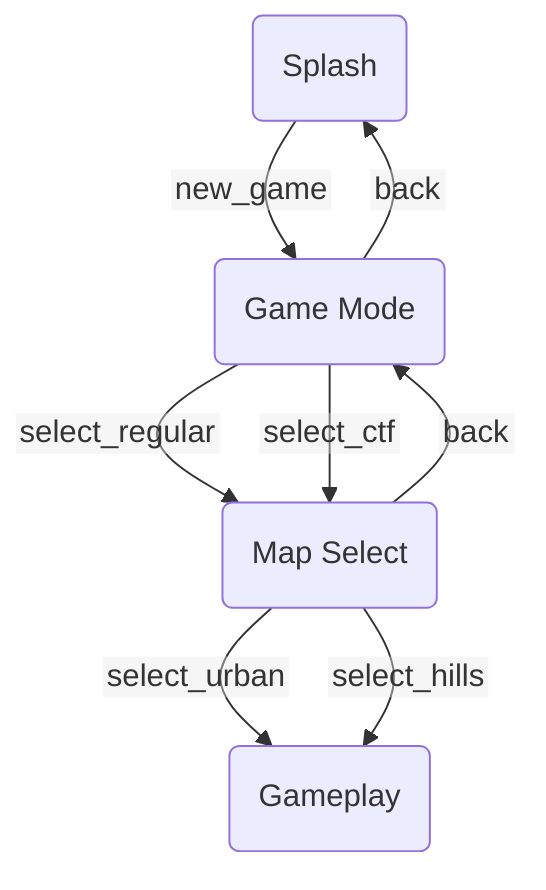

# tbgwaf

A turn-based tactics prototype: two 3-figure squads (Blue vs Red) fight on a
blocky obstacle field, each side fogged from the other's view, until one team
is eliminated.

**[Play it in your browser](https://thedeepestspace.github.io/tbgwaf/)** --
both players on one screen, no install required.

The page also includes **Blue vs Jev** and **Jev vs Jev** preview modes. They
use the same WASM game and require a server-side TypeSafe adapter; the API key
is never sent to the browser. See [Jev gameplay preview](docs/jev-preview.md)
for local setup, Pages/PR-preview URLs, deployment, limits, and smoke tests.

## Play in browser

The [live Pages build](https://thedeepestspace.github.io/tbgwaf/) is the same
native game compiled to WebAssembly/WebGL2. The page shows two canvases side
by side -- Blue on the left, Red on the right -- each with its own client
instance of the game (own camera, input, and UI); the WASM module is
instantiated once per canvas. Both teams plan at once: each instance sends
its own team's plans to the other over an in-page message bus, and Commit
Round (from either canvas) makes the Blue instance run the simulation and
broadcast it, which the Red instance mirrors. Cross-machine play is not
supported. See [Controls](#controls) below.

## Native build

```sh
cmake -B build -G Ninja -DCMAKE_BUILD_TYPE=Release
cmake --build build
ctest --test-dir build --output-on-failure
```

Run the game with `./build/tactics_app`. `ctest` also runs a headless
smoke test under `xvfb-run` if available.

Environment knobs: `TBGWAF_MAP_SEED=<n>` reseeds the procedural map.
The default map (also what the web build serves) is `urban-elevated`; the plain urban map lays an oblique boundary-to-boundary artery with
angled avenues/cross streets and polygon blocks whose buildings follow
their frontage; `TBGWAF_MAP=urban-merge` adds a wide branching avenue that
merges into the artery, `TBGWAF_MAP=urban-elevated` (default) turns the artery into a
true overpass (ramps up, crosses on pier bents with usable ground beneath,
ramps back down; the branch becomes an on-ramp merging mid-deck), and
`TBGWAF_MAP=hilly` selects rolling hills. Urban code/scenarios can also
tune artery count/width, local-street width/skew and elevation through
`MapGeneratorConfig` / `map.generate`. Press **N** in-game to toggle a debug
overlay of the navmesh's walkable-cell boundaries.

Every arterial city has **terrain levels** (issue #155): 1–3 map-spanning
raised levels, drawn per seed. Each level is a straight step across the whole
map, roughly across the artery: everything on one side rises 1–5 figure
heights behind a sheer concrete cliff. The levels are drawn like the
buildings: each tier is an extruded polygon (flat top, vertical sides), a
ramp through a level is a rectangular cutout exactly the width of its
pavement, and a stair is one extruded trapezoid (a straight flight and a flat
landing at the level's height) attached to the cliff face. A level edge is a
block boundary like a street: a 6.4-unit band centered on it is carved from
the blocks on both sides, so sidewalk rings and buildings keep a street's
setback from the cliff. Steps overlap into nested tiers at different
heights, with sharp edges (no rolling noise). The sampled heightfield only
drives movement (an unseen nav wall along each cliff keeps figures off the
edge). The terrain is planned first;
the highway profile is then chosen against it per seed: the artery stays at
grade and ramps through every wall (a main road cutting through the levels),
or climbs onto a deck before a run of walls, flies over them clear of the
highest tier and settles onto the level beyond, with either ramp optionally
replaced by an elevated map edge, up to one tall deck above every level. The
branch merges onto whatever the artery is doing and ramps through the walls
it meets at grade. A local street never runs into a level or across a road
that is ramping through one: an avenue may ramp through a level; any other
street whose pavement would reach the level band or a ramp corridor stops at
the last street it crossed before it (a T, not an X) and resumes at the first
one beyond it, and the blocks either side of the missing stretch stay one
block; where that last street itself ends at the junction (an L), the street
instead runs on as a dead end stopping just short of the band or corridor, so
no street ever pokes into a block. Sidewalk rings are one flat plane per
strip, on the tier beside the cliff. Switch the levels off with
`TBGWAF_TERRAIN=off`, `MapGeneratorConfig::features.terrain`, or scenario
YAML:

```yaml
map:
  generate:
    type: urban
    seed: 7
    elevated: false
    features: {terrain: on}
    terrain_levels: -1 # seeded 1–3; 0 keeps the city flat
```

The legacy orthogonal generator stays flat. `city_terrain_seed_*` goldens
cover seeds 7, 42 and 2024 at grade and `city_terrain_elevated_seed_16` a
deck over the levels; the flat-city goldens pin terrain off.

Urban buildings have an **archetype** (`Scene::buildings`, one `Building` per
parcel beside its obstacle): residential, mixed-use, office, commercial hall,
garage, or civic for the two landmark towers. Each parcel's kind is drawn
from a table weighted by the street it fronts (artery frontage leans
office/mixed-use, back streets residential/warehouse), biased by its block's
neighbourhood character (downtown, residential, industrial or mixed; drawn per
block, or forced with `TBGWAF_BLOCK_CHARACTER=downtown` / scenario
`map.generate.character`). Floor count and floor height per kind set the
building height; the renderer colours facades per kind and draws
massing -- parapets, roof furniture, awnings over shopfronts, set-back office
top floors. Massing blocks sight lines and FOV (`SightObstacles`) but not
movement; the set-back top floor is full obstacle geometry.

Buildings also carry **facade openings** (issue #152, `Scene::facadeOpenings`):
a per-kind window grid per floor on every street facade (shopfront glazing on
mixed-use ground floors, a sparser grid on the courtyard wall) and the doors,
each recorded as data (wall edge, u-range, floor, kind) and rendered as pane
extrusions -- window frames extruded out of the wall (with exterior sills on
some residential buildings, flatter thinner frames on office ribbon glazing),
while doors and the factory-style grid windows of commercial halls are
recessed into the building body through a real hole in the drawn wall face --
so a later stage can turn the same records into gameplay holes without
re-rolling where they are. Nearly every building gets a street
entrance on its frontage: some entrances climb a short stoop walk-up while
the rest open straight off the ground, and some buildings add a rear
courtyard door, usually raised on a little platform whose access ramp lands
on one of its three free sides (seed-drawn). Stoops and platforms are real
`WalkSurface`s -- knee-high concrete a figure can stand on -- while the
windows and doors themselves stay visual for now. Switch the openings off
with `MapGeneratorConfig::features.facades` or scenario YAML
`map.generate.features: {facades: off}`.

Urban maps carry pre-built **ziplines** (0-2 per block, seed-deterministic,
`MapGeneratorConfig::maxZiplinesPerBlock`): two-way cables between anchor
posts along the block sidewalks. A move plan may walk to one anchor, ride,
and walk on from the other; a ride costs `length * kZiplineCostFactor`
(0.25, in `game/Types.h`) of the figure's per-round move budget, so a longer
line spends more of the turn. The move frontier draws that reach as a second
(cyan) region with the line highlighted. One rider per line at a time (a
second rider waits at the anchor), and a rider can't shoot. Scenarios add
lines with `map.ziplines: [{from: [x,y,z], to: [x,y,z]}]` and assert an
out-of-reach move with `expect_unreachable: true`.
The app defaults to the prototype per-unit shadow-map FOV mask (tints
walls, roofs and deck sides too; see
[docs/fov-shadow-map.md](docs/fov-shadow-map.md)); `TBGWAF_FOV_SHADOW_MAP=0`
restores the analytic FOV-cone overlay. Visual scenarios still default to
the analytic overlay and opt in
with a `render: {fov_overlay: shadow_map}` block.

The debug panel's **Thermal view** uses black-hot polarity by default, based
on the references in PR #178: pale clay-like surroundings, gray streets and
dark figures. Screen-space ambient occlusion adds soft contact shading at
building bases, parapets, roof furniture and feet. It samples nearby visible
geometry, so hidden/offscreen surfaces cannot contribute. Uncheck **Black hot**
to invert the complete image. Apparent heat is assigned by material,
independent of team colors; this is a visual approximation, not a temperature
simulation. Light sensor blur and grain affect the shaded world before the green
gameplay overlays and HUD are drawn. The `thermal_urban_black_hot` and
`thermal_urban_white_hot` scenarios show both polarities on the same city;
scenario YAML selects them with `render: {thermal: true, thermal_black_hot: false}`
for white-hot (omit `thermal_black_hot` for black-hot).

**Baked thermal** (off by default) replaces the screen-space march with a
world-space ambient-cube volume (PR #178). Static FOV geometry and terrain
are rasterized from directions covering the full sphere, so walls at eye
level, open space under overpasses, and deck undersides receive shading.
Camera moves and pane changes reuse the volume. Visible figures add two
live contact spheres each; fog-hidden figures contribute nothing.

- **AO radius** is the contact reach in world units (default 2.4).
- **AO quality** sets `clamp(quality * 16, 16, 256)` directions (default 96).
  Radius and quality apply on slider release and rebake once.
- **AO strength** stays live (default 1.9); **AO softness** is disabled in
  baked mode. Switching back restores the screen-space settings.
- `AmbientOcclusionSettings::bake` exposes depth resolution (1024²), batch
  layers (16, maximum 16), probe spacing (0.75), and a direction override
  for tests (0 uses quality). The grid widens its spacing if necessary to
  stay within 256 × 64 × 256. Geometry and bake-setting changes invalidate
  the content hash; units and camera state do not.

The bake is synchronous, including in WebGL2. It logs settings, bounds,
completed GPU time and memory. On this change's llvmpipe runner,
`city_elevated_seed_7` took **4.3 s** at defaults (203 × 33 × 203 probes,
10.4 MiB resident volume, 64 MiB temporary depth maps). Ping-pong accumulation
needs another volume pair during baking, plus the previous volume on a
rebake. The test settings (16 directions, 256², spacing 1.5) took **0.35 s**
on the same map; the thermal regression suite stays below its 30 s timeout.
These are software-renderer measurements; the **under-2 s GPU target has
not been measured on hardware**.

Depth maps use exit faces toward the receiver: entry faces on the far side
of a thick building would count its thickness as distance and lose contact
shading. Terrain stays two-sided because its mesh is open underneath.
This is still a directional-depth approximation, not ray-traced AO:
a farther caster can hide a nearer one in a direction. Thin features below
the probe/depth resolution are softened. Invalid solid probes are filled
from neighbouring open probes in two passes before trilinear lookup.

Native-only inspection (no files or PNG dependency in the game/WASM):

```sh
LIBGL_ALWAYS_SOFTWARE=1 xvfb-run -a build/tactics_map_visual_tests --dump-ao build/ao-dump
# Faster diagnostic bake; --map accepts an existing map-case name.
LIBGL_ALWAYS_SOFTWARE=1 xvfb-run -a build/tactics_map_visual_tests \
  --dump-ao build/ao-dump-small --ao-test-settings --map city_elevated_seed_7
```

Dump mode defaults to `city_elevated_seed_7` and skips golden comparisons.
It writes `thermal.png` and one `slice-NNN.png` per Z layer beneath the map's
name: each XY slice has +X/+Y/+Z visibility in RGB on the left and -X/-Y/-Z
on the right, with filled validity in alpha. Rows run from high to low Y;
Z increases with the slice number. All normal thermal goldens continue to
use screen-space defaults and are unchanged.

### Flag objective (CTF part 1)

A scene (or scenario YAML `flag:` block) can enable a neutral flag at the map
center (or the nearest free spot; `flag: {position: [x, z]}` overrides). A
living figure whose move passes through the flag's spot picks it up for free
and its team wins at once; `win_on_grab: false` instead just carries it
(stowed on the figure's back) while play continues. A carrier acts as normal;
if it dies the flag drops there and anyone passing picks it up. If several
figures reach it in the same tick the earliest arrival wins, with an exact tie
going to the lowest unit id. The flag is a neutral objective, so fog never
hides it (a carried one shows with its carrier). `round_limit: N` ends the
match as a draw after N rounds with no winner. Flag state travels in the
snapshot text protocol (`ExportState`/`ImportState`).

### Gameplay scenario tests

`tests/scenarios/*.yaml` are state-only (no rendering) gameplay regression
tests: each declares a map + starting units, then a scripted sequence of
player-equivalent actions (`move`/`shoot`/`pass`/`cancel`, driven through the
same click/choose API the interactive game uses) interleaved with
assertions on the resulting state (alive/dead, position, per-team FOV
visibility, round number, winner). They run as the
`scenario_tests` ctest target; see `tests/scenario/Scenario.h` for the full
field reference and `tests/scenarios/*.yaml` for examples.

### Visual regression tests

The same scenarios also run in an expensive *visual* mode (the
`visual_tests` ctest target, headless under `xvfb-run` like the smoke
test): for every turn of every scenario, both teams' fog-of-war panes are
rendered through the exact same `gfx::SceneRenderer` pass the app uses and
captured as one PNG per team per turn, then diffed against the checked-in
goldens under `tests/goldens/` with a pixelmatch-style tolerance
(per-channel threshold + max differing-pixel fraction, so driver/AA noise
doesn't fail the build but object-sized changes do).

When a visual change is *intentional*, regenerate and commit the goldens:

```sh
scripts/update_golden_baselines.sh
```

The runner (`build/tactics_visual_tests`) can also record a continuous
per-team video of each scenario with `--video` (requires `ffmpeg`); see
`--help` for the flags.

### Weapons & the asset/animation gallery

Figures carry one of three procedural blocky weapons (issue #126), assigned
deterministically by unit id (`id % 3`): 0 = assault rifle, 1 = sniper
rifle, 2 = Desert Eagle — so every squad of three fields one of each. The
weapon sets the figure's animation class: rifles (AR + sniper) are carried
two-handed across the chest (both arms IK-solved onto the weapon, no arm
swing while running) and shoulder-aimed for shots; the Desert Eagle keeps
the one-handed low-ready carry and quick-draw shot. Weapons are visual
only — hit resolution is identical across them, though each weapon has its
own fire interval and bullet-scatter cone (every bullet of a burst flies its
own line).

Every weapon model and animation can be inspected on the **asset &
animation gallery**, a standalone page built alongside the game:
[live gallery](https://thedeepestspace.github.io/tbgwaf/gallery/) on Pages,
and `pr-preview/pr-<number>/gallery/` in each PR preview. The page lists
the three weapon turntables plus idle/run/shoot/empty-mag and downhill/uphill zipline rides per weapon — the
empty-mag clip dumps the whole magazine at the weapon's own fire interval,
each bullet leaving its own scattered tracer line (drag to orbit,
scroll to zoom, play/pause and scrub the loop). The catalog, framing, and
renderer live in `src/gallery/GalleryScene.*`, shared verbatim between the
web viewer (`src/gallery/gallery_main.cpp` + `web/gallery.html`) and a
native interactive build, `build/tactics_gallery_app` (left/right switch item, space pauses).

### PR scenario review page

Every pull request gets a **scenario review page** in its Pages preview:
per-team WebM videos of every scenario present at the PR's head, grouped by
how the PR changes each one (new/modified/unchanged, classified purely from
git metadata on the YAML files, not from screenshot diffs; deleted
scenarios are listed by name), generated by
`scripts/generate_scenario_review_page.py` and deployed to
`pr-preview/pr-<number>/scenarios/` by the same PR-preview workflow. The
workflow comments a direct link on the PR.

### Performance suite

The **Performance suite** is an observational native/software-GL benchmark
for 10 pinned, randomly selected `urban-auto` map seeds. It initializes the
normal six figures and map-fitted two-pane camera, warms up the renderer, and
records 120 frames of the debug-panel measurements: FPS/frame time, FOV time,
draw calls, triangles, and vertices. Raw JSON retains every sample plus
per-map and whole-run percentiles; no timing value is a pass/fail CI gate.

Run the **Performance suite** workflow manually and choose a branch, tag, or
SHA. It builds Release under Xvfb/llvmpipe, uploads the raw result, preserves
the run in `gh-pages`, and refreshes the [published report](https://thedeepestspace.github.io/tbgwaf/performance/).
Every PR preview also measures the PR head and publishes `pr-preview/pr-<number>/performance/`, compared against the preserved master runs.
Master runs form the baseline shown beside measurements from other refs.
Locally, after a Release configure:

```sh
cmake --build build --target tactics_performance_suite
LIBGL_ALWAYS_SOFTWARE=1 SDL_VIDEODRIVER=x11 \
  xvfb-run --auto-servernum --server-args='-screen 0 1280x1024x24' \
  build/tactics_performance_suite --output performance-results.json
```

## Web (WASM) build

Requires the [Emscripten SDK](https://emscripten.io/docs/getting_started/downloads.html)
(already installed and on `PATH` in this repo's devcontainer):

```sh
emcmake cmake -B build-web -G Ninja -DCMAKE_BUILD_TYPE=Release
cmake --build build-web
```

This produces `build-web/tactics_app.{html,js,wasm}`. Serve the directory
with any static file server (e.g. `python3 -m http.server -d build-web`) and
open `tactics_app.html` -- it can't be opened as a `file://` URL, browsers
block WASM/fetch from local files. Pushes to `master` build and publish this
target to GitHub Pages automatically (`.github/workflows/pages.yml`).

Pull requests also get their own preview build, published to a per-PR
subdirectory (`pr-preview/pr-<number>/`) on the `gh-pages` branch
(`.github/workflows/pr-preview.yml`) without touching the production build.
The workflow comments on the PR with a link to the preview once it's ready,
and removes the preview automatically when the PR closes.

## App flow

Screen flow (Splash -> Game Mode -> Map Select -> Gameplay), declared in
`flow/app_flow.yaml`. The build regenerates `flow/app_flow.mmd` from it; paste
that file's contents below if the flow changes.



## Controls

- **Left click** one of your own figures (in your own viewport) to select
  it, then choose **Move**, **Shoot**, or **Pass** from the
  action menu.
  - Move: click a destination on the ground; the figure paths around
    obstacles via its navmesh. A move can only reach as far as the figure
    can run within one round's fixed execution window.
  - Shoot: click an enemy figure. Once the round executes, the shot fires
    the first instant the target is within your figure's forward-facing FOV
    cone with a clear line of sight -- including mid-round, if the target
    only walks into view while the round plays out. If that never happens
    before everything stops moving, the shot expires as a miss.
- **Right-click drag** to orbit the camera; **scroll** to zoom. Either side
  can freely look around its own viewport at any time.
- **Esc** cancels the current action/selection.

Rounds are simultaneous (WEGO): both teams plan every living figure
concurrently -- each viewport only accepts clicks for its own squad -- and a
single **Commit Round** then executes both sides' plans together, moves
animating concurrently and shots resolving continuously against live
FOV/line-of-sight. Two figures shooting each other in the same instant both
go down (wiping out both squads at once is a draw). Play continues round by
round until a team is eliminated.
